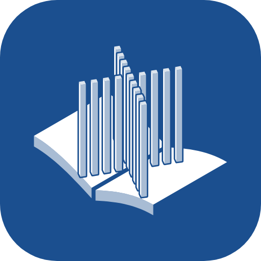
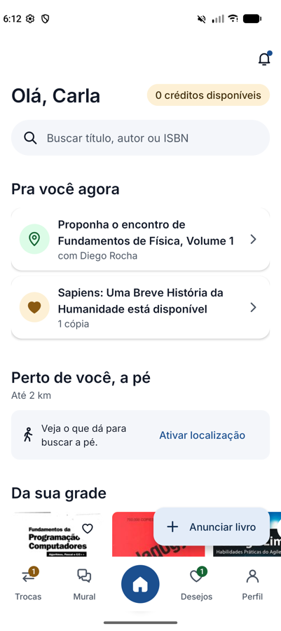
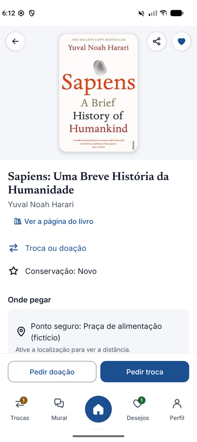
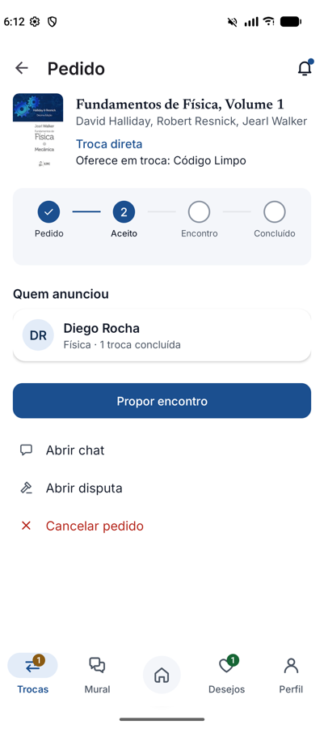
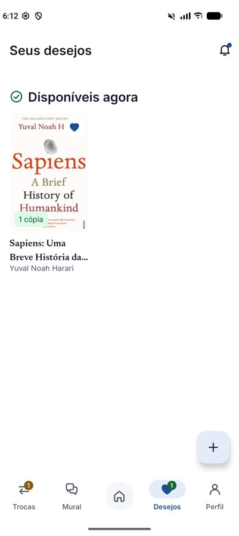

<div align="center">



# LeiaUFMS

**Troca de livros entre alunos da UFMS, sem dinheiro, em pontos seguros do campus.**


[Visão geral](#visão-geral) · [Recursos](#recursos) · [Como rodar](#como-rodar) · [Demonstração](#demonstração) · [Arquitetura](#arquitetura) · [Documentação](#documentação)






</div>

## Visão geral

O LeiaUFMS é um app Android nativo em que alunos da UFMS trocam livros um por outro ou passam um livro adiante. Quem doa ganha 1 crédito, e o crédito resgata outro livro. A entrega acontece em pontos seguros do campus, combinada pelos dois lados, e a localização de cada um só fica visível para o outro nos 10 minutos antes do encontro.

O app sempre mostra qual é o próximo livro e qual é o próximo passo. O Início recomenda livros das disciplinas reais do seu curso, e cada troca mostra em que etapa está e o que falta fazer.

> [!NOTE]
> Projeto da Avaliação 3 de Programação Mobile da UFMS. Integrantes: Pedro Lucas de Souza Cremonini, Gabriel Mattos de Aquino e Angelo Antonio Correia de Souza.

## Recursos

- **Trocas e créditos.** Troca direta ou resgate com crédito, com reserva de crédito, prazos de 72 horas e 7 dias, disputa decidida pelo Moderador e um registro de cada movimentação de crédito.
- **Encontro combinado pelos dois.** Um lado propõe o ponto seguro e o horário, e o outro aceita ou sugere outro. Uma faixa fixa mostra quanto falta para o encontro e quanto tempo você leva a pé até o ponto.
- **Catálogo e recomendações.** São 3.055 livros da Open Library ligados às 5.551 disciplinas da UFMS de 2026. Ao digitar um título, o app sugere livros do catálogo e, com internet, busca na Open Library a edição em português de qualquer outro livro, padronizando título e autor. O Início traz "Da sua grade", "Perto de você, a pé", "Porque você leu" e gêneros.
- **Desejos.** O app avisa quando alguém anuncia um livro que você deseja, mostra o que já está disponível e quantas pessoas também querem cada livro.
- **Mural.** Dicas, procuras, doações e trocas concluídas, com coração, salvar e comentários. O mural é finito, e quanto mais corações um post recebe, mais tempo ele fica visível.
- **Conta e segurança.** Cadastro só com e-mail da UFMS e curso da lista oficial, senha com BCrypt (custo 12) e sessão por token, guardada no banco só como hash.
- **Recursos do aparelho.** Câmera e galeria para fotos, localização sob demanda, mapa com MapLibre, notificações com um aviso próprio no tema quando o app está aberto, e capas da Open Library.

## Como rodar

**Pré-requisitos:** Android Studio 2026.1 ou mais novo, e um emulador ou celular com Android 8.0 (API 26) ou mais novo.

1. Clone o repositório e abra a pasta no Android Studio.
2. Espere a sincronização do Gradle.
3. Rode a configuração `app`.

Pela linha de comando:

```bash
./gradlew assembleDebug        # APK em app/build/outputs/apk/debug/
./gradlew testDebugUnitTest    # testes JUnit
```

> [!TIP]
> Se a linha de comando não encontrar o Java, use o JDK que vem com o Android Studio: `export JAVA_HOME="/Applications/Android Studio.app/Contents/jbr/Contents/Home"` (macOS).

## Demonstração

Na primeira abertura, o app cria contas de demonstração e carrega o catálogo. Todas as contas usam a senha **`Leia2026`**.

| Conta | Papel | Curso |
|---|---|---|
| `moderacao@ufms.br` | Moderador | — |
| `ana.souza@ufms.br` | Aluna | Letras |
| `bruno.lima@ufms.br` | Aluno | Engenharia Civil |
| `carla.mendes@ufms.br` | Aluna | Ciência da Computação |
| `diego.rocha@ufms.br` | Aluno | Física |

Roteiro curto:

1. Entre como **Carla**. O Início mostra "Pra você agora" e "Da sua grade".
2. Abra um livro e toque em **Resgatar** ou **Pedir troca**.
3. Entre como quem anunciou, aceite o pedido em **Trocas** e proponha o encontro.
4. Volte para a Carla, aceite o horário e confirme a entrega depois do encontro. O doador ganha 1 crédito.

> [!IMPORTANT]
> O seed traz 3 pontos seguros padrão com coordenadas reais do campus: Biblioteca Central, Restaurante Universitário e Concha Acústica. O Moderador cadastra outros pontos em Perfil → Pontos seguros, tocando no mapa.

## Arquitetura

O app é escrito em Java, com telas em XML (Views) e Material 3, seguindo o padrão MVVM com ViewModel e LiveData. Os dados ficam num banco local Room (versão 8, com migrações desde a versão 1). A navegação usa um único Activity com Navigation Component, e o WorkManager cuida de prazos, lembretes e capas.

| Pasta | Conteúdo |
|---|---|
| `app/src/main/java/.../data` | Entidades, DAOs, repositórios, máquina de estados do pedido, regras de crédito |
| `app/src/main/java/.../ui` | Telas por área: início, livro, trocas, encontro, mural, desejos, perfil |
| `app/src/main/assets/catalogo.json` | Catálogo de livros, tópicos e disciplinas, gerado por `tools/catalogo` |
| `tools/` | Geradores do catálogo, da lista de cursos, dos ícones e do logo |
| `docs/` | Especificação, design system, arquitetura, testes, log e decisões |

Fontes de dados abertos: livros da [Open Library](https://openlibrary.org/developers/api) (CC0), e cursos e disciplinas do [Portal de Dados Abertos da UFMS](https://dadosabertos.ufms.br/) (CC BY).

## Documentação

| Documento | Conteúdo |
|---|---|
| [Especificação](docs/02-especificacao.md) | Visão geral, papéis e requisitos RF-01 a RF-45 |
| [Relatório de testes](docs/05-relatorio-testes.md) | 24 casos de teste caixa-preta |
| [Arquitetura](docs/04-arquitetura.md) | Stack, pacotes, modelo de dados e máquina de estados |
| [Design](DESIGN.md) e [design system](docs/03-design-system.md) | Cores UFMS, tipografia, componentes, navegação |
| [Jornada e usabilidade](docs/08-jornada-e-usabilidade.md) | Jornada do aluno, critérios das recomendações e decisões |
| [Ícones](docs/09-icones.md) e [logo](docs/logo/README.md) | Conjunto de ícones próprio e logo do Paliteiro |
| [Log de implementação](docs/06-log-implementacao.md) | O que foi feito e verificado em cada parte |
