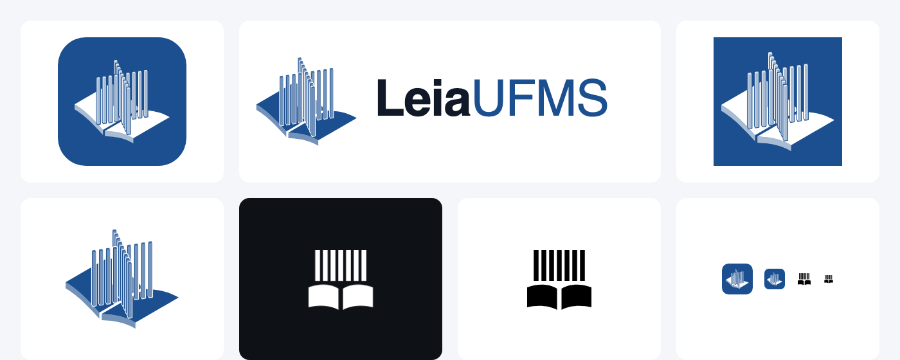

# Logo LeiaUFMS

Feito com a skill `/logo-design` (03/11/2026). Direção escolhida pelo Pedro: o **Paliteiro**, monumento da UFMS, em 3D e de pé sobre um livro aberto. O livro aberto é o livro que passa de mão em mão, e o Paliteiro é o campus.

## Ideia em uma frase

O Paliteiro da UFMS, com colunas quadradas em quatro eixos e todas com a mesma altura (topo reto), de pé sobre um livro aberto.

## Construção

- Gerador: `tools/logo/gerar_logo.py` (geometria em `tools/logo/iso3.py`). Ele gera os vetores do Android e os SVG desta pasta.
- Perspectiva isométrica (30°). O monumento é girado 30° em relação à vista para os quatro braços aparecerem separados.
- Colunas: 1 no centro e 4 por braço, seção quadrada de 0,7, passo de 1,55 e altura de 24, todas iguais (palitos altos, como o monumento). Cada coluna tem a face de luz em 100%, a face de sombra em 62% e o topo em 85%.
- Livro: duas páginas que sobem da lombada e achatam (seno), com o bloco de folhas visível na frente.
- Separação entre as colunas: um contorno na cor do fundo, sem traço de outra cor.

## Versões

| Arquivo | Uso |
|---|---|
| `leiaufms-icone.svg` | Ícone do app: branco sobre o bloco azul com cantos arredondados |
| `leiaufms-simbolo-azul.svg` | Símbolo azul sobre fundo claro (splash, login) |
| `leiaufms-simbolo-branco.svg` | Símbolo branco sobre azul, sem cantos |
| `leiaufms-horizontal.svg` | Símbolo + "LeiaUFMS" (Leia em 700, UFMS em 400 no azul). O texto está em Inter e precisa virar contorno antes de qualquer impressão |
| `leiaufms-plano.svg` | Versão plana de uma cor: livro aberto + 7 palitos altos de mesma altura. É a que funciona em 24 px ou menos |

No app:

- `ic_launcher_foreground` e `ic_launcher_background`: ícone adaptativo, com o símbolo em 60 dp dentro da zona segura de 66 dp (o círculo do launcher corta o resto).
- `ic_launcher_monochrome`: ícone temático do Android 13+, na versão plana.
- `ic_splash`: splash e login, em azul sobre o fundo do tema.
- `ic_notification`: barra de status, na versão plana em branco.

## Regras de uso

- **Cores:** azul UFMS `#1B4F8F` e branco. Sem outras cores no símbolo.
- **Tamanho mínimo:** a versão 3D vale a partir de 40 px. Abaixo disso, use a versão plana.
- **Área de respiro:** a largura de 2 colunas em volta do símbolo.
- **Não fazer:** esticar, girar, mudar a altura dos palitos (o topo é reto), usar a marca oficial da UFMS junto sem autorização da universidade, nem aplicar o símbolo sobre fotos sem o bloco azul.

## Pendências

- Converter o texto do logo horizontal em contorno.
- Fazer uma busca de marca antes de qualquer uso público. A skill não garante que a marca está livre.
